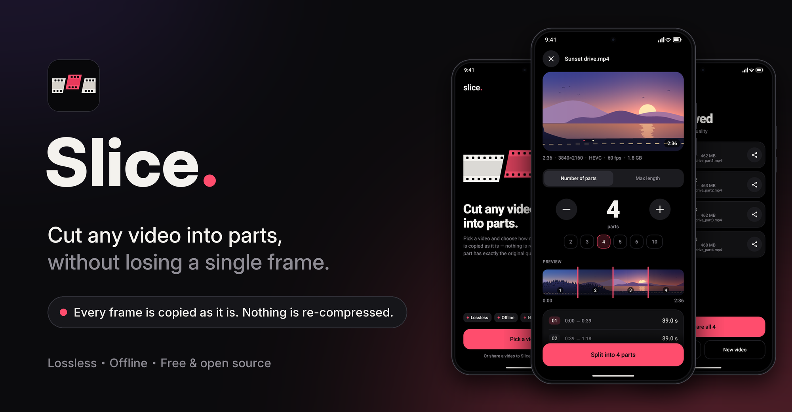
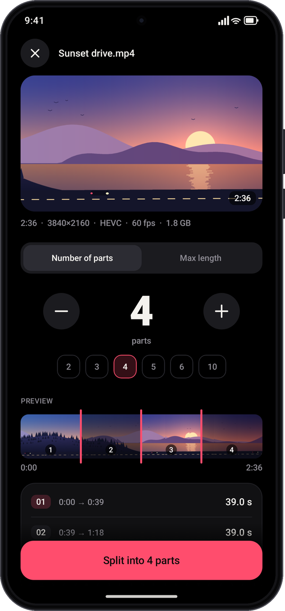
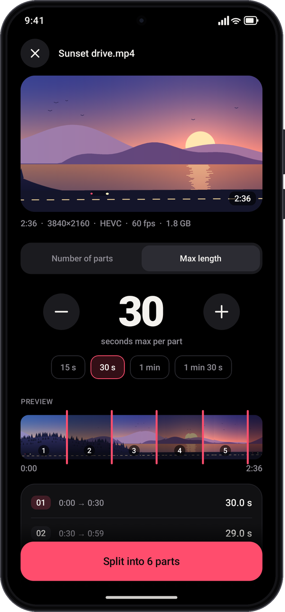
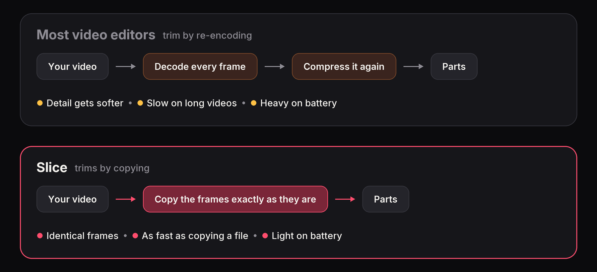
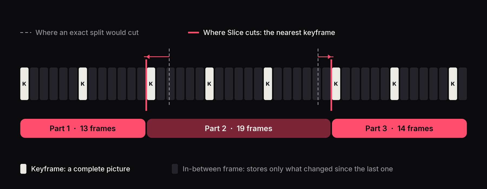
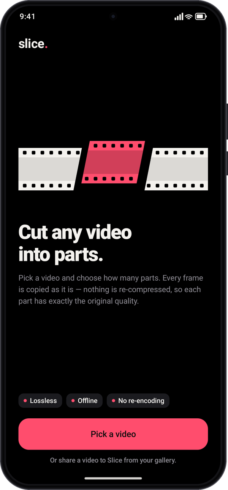
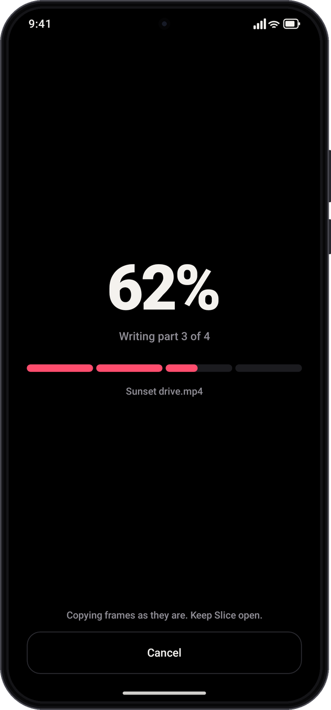
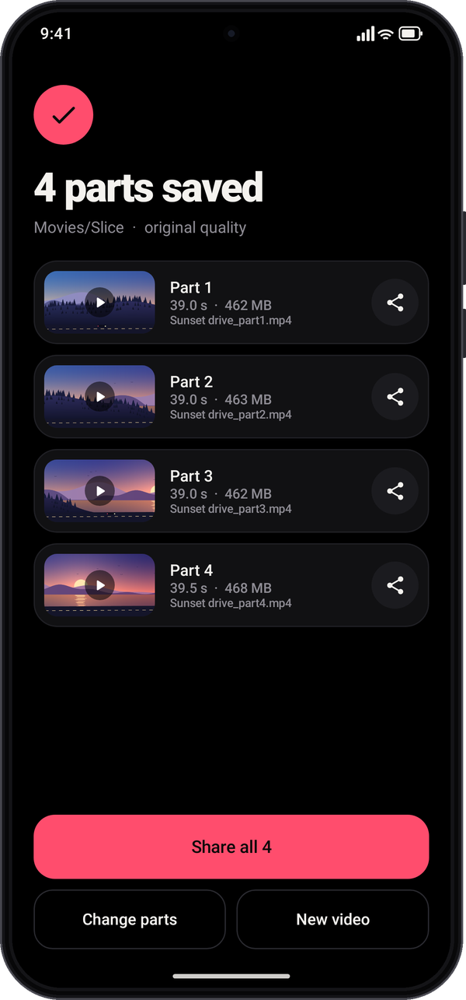
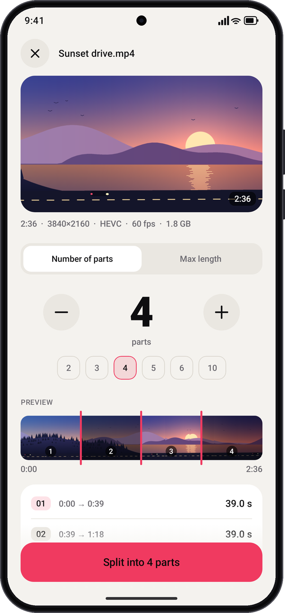

<p align="center">
  
</p>

<p align="center">
  <a href="https://github.com/Shivanshxsharma/slice/releases/latest/download/Slice.apk"></a>
</p>

<p align="center">
  <a href="https://github.com/Shivanshxsharma/slice/releases/latest"></a>
  
  <a href="https://github.com/Shivanshxsharma/slice/releases"></a>
  <a href="LICENSE"></a>
</p>

<h3 align="center">Split a long video into equal parts, or into 30-second pieces for Status and Stories.<br>Right on your phone, without re-encoding a single frame.</h3>

<br>

## Why Slice

<table>
  <tr>
    <td width="33%" valign="top">
      <h4>🎞️&nbsp; Exact original quality</h4>
      Slice never decodes or re-compresses your video. Every frame and every bit of sound in the parts is the original data, copied byte for byte. 4K stays 4K, 60 fps stays 60 fps.
    </td>
    <td width="33%" valign="top">
      <h4>⚡&nbsp; As fast as copying a file</h4>
      With nothing to encode, a split takes about as long as copying the video once, with no heavy processing in between.
    </td>
    <td width="33%" valign="top">
      <h4>✂️&nbsp; Two ways to split</h4>
      Ask for a number of parts, or for a maximum length per part. Type any number, or tap a quick pick.
    </td>
  </tr>
  <tr>
    <td width="33%" valign="top">
      <h4>👀&nbsp; See the cuts first</h4>
      A filmstrip shows exactly where every cut lands, with each part's length, before anything is written.
    </td>
    <td width="33%" valign="top">
      <h4>🔒&nbsp; Private by design</h4>
      The app has no internet permission, so your videos can't leave the phone. No account, no ads, no watermark.
    </td>
    <td width="33%" valign="top">
      <h4>📤&nbsp; Share in one tap</h4>
      Parts land in your gallery. Share one or all of them anywhere, or send a video to Slice straight from your gallery's Share menu.
    </td>
  </tr>
</table>

<br>

## Two ways to split

<table>
  <tr>
    <td align="center" width="50%"></td>
    <td align="center" width="50%"></td>
  </tr>
  <tr>
    <td valign="top"><b>Number of parts.</b> Type how many parts you want, or tap 2, 3, 4… Slice spreads the cuts as evenly as the video allows and lists every part with its exact length.</td>
    <td valign="top"><b>Max length.</b> Enter seconds, for example 30 or 60 for Status and Stories. Every part stays within your limit; the last one simply holds whatever is left.</td>
  </tr>
</table>

<br>

## How it keeps the quality

<p align="center"></p>

A video file holds compressed frames. Most editors trim by decoding every frame back into pixels and compressing them all over again. That second compression throws detail away, takes a long time, and works the processor hard.

Slice skips both steps. It reads the compressed frames and audio straight out of your video and writes them, untouched, into new files. Only the wrapper around them is new. The picture in each part is bit-for-bit the picture in your original.

<br>

## Why the parts aren't exactly equal

<p align="center"></p>

Videos store a complete picture, a **keyframe**, every so often (about once a second in phone recordings). The frames in between only store what changed. A part has to begin on a keyframe, or its first frames would have nothing to build on.

So Slice moves each cut to the nearest keyframe. Parts come out within about a second of each other, and the preview shows you the real cut points before you split. If a video has very few keyframes (some screen recordings do), Slice tells you how many parts are possible instead of guessing.

<br>

## From pick to share

<p align="center">
  
  &nbsp;&nbsp;
  
  &nbsp;&nbsp;
  
</p>

<p align="center">Pick a video &nbsp;→&nbsp; watch it split &nbsp;→&nbsp; play or share the parts.</p>

<br>

## Light or dark, like your phone

<p align="center">
  
  &nbsp;&nbsp;&nbsp;
  
</p>

<br>

## Install

1. On your phone, download **[Slice.apk](https://github.com/Shivanshxsharma/slice/releases/latest/download/Slice.apk)** from the [latest release](https://github.com/Shivanshxsharma/slice/releases/latest).
2. Open it. If Android asks, allow your browser or Files app to install apps.
3. Play Protect may say it doesn't recognise the developer, because the APK isn't from the Play Store. Choose **Install anyway**.

To update, install the newer APK over the old one. Needs Android 10 or newer.

<br>

## Questions

<details>
<summary><b>Is the quality really identical?</b></summary>
<br>
Yes. Slice uses Android's own media tools (<code>MediaExtractor</code> and <code>MediaMuxer</code>) to move the compressed frames and audio packets from your file into the new files. The pixels are never decoded, so there is nothing to lose. Resolution, frame rate, bitrate and colour data all come along unchanged.
</details>

<details>
<summary><b>Which videos work?</b></summary>
<br>
Anything your phone records, and most downloaded videos: MP4, MOV, 3GP, MKV and WebM files with H.264, HEVC (H.265), MPEG-4, H.263, VP8 or VP9 video. AV1 works on Android 14 and newer. Dolby Vision is kept on Android 13 and newer; older Android saves the same picture data as plain HEVC. Audio: AAC and AMR (in MP4), Vorbis and Opus (in WebM). If a track can't be copied as it is, Slice tells you instead of re-encoding it.
</details>

<details>
<summary><b>Why can't I choose more parts?</b></summary>
<br>
Each part needs its own keyframe to start on, so a video can be split into at most as many parts as it has keyframes. For a phone recording that's roughly one part per second of video. Slice shows the limit when you reach it.
</details>

<details>
<summary><b>Where are the parts saved?</b></summary>
<br>
In <code>Movies/Slice</code> on your phone, named after the original (<code>Sunset drive_part1.mp4</code>, <code>Sunset drive_part2.mp4</code>, …). They show up in your gallery straight away. Your original video is never changed.
</details>

<details>
<summary><b>Does Slice upload my videos or need permissions?</b></summary>
<br>
No. The app has no internet permission, so it can't send anything anywhere. It doesn't need storage permission either: Android's picker gives it only the video you choose, and the parts are saved through Android's media store.
</details>

<details>
<summary><b>Do the parts keep the rotation and location?</b></summary>
<br>
Yes, for MP4 (what phones record). Each part keeps the original's rotation and location tag, so portrait videos stay upright and your gallery can still place them on a map.
</details>

<br>

## Under the hood

Slice is a small native Android app: Kotlin and Jetpack Compose, with no video libraries beyond what Android ships.

| File | What it does |
|---|---|
| [`VideoProbe.kt`](app/src/main/java/com/shivansh/slice/split/VideoProbe.kt) | Reads the video and lists its keyframes, hopping from keyframe to keyframe instead of reading the whole file |
| [`CutPlanner.kt`](app/src/main/java/com/shivansh/slice/split/CutPlanner.kt) | Picks the cut keyframes for "number of parts" and "max length" |
| [`PartFilter.kt`](app/src/main/java/com/shivansh/slice/split/PartFilter.kt) | Decides, sample by sample, which part every frame and audio packet belongs to |
| [`Splitter.kt`](app/src/main/java/com/shivansh/slice/split/Splitter.kt) | Copies the samples with `MediaExtractor` → `MediaMuxer` into `Movies/Slice` |

The planner and the routing are tested on the PC against the real packet lists of three videos: H.264 the way phones record it, H.264 with B-frames, and open-GOP HEVC. The tests check that no frame or audio packet is lost or duplicated, that every part starts on a keyframe, and that the audio splits exactly at the cuts. (Open-GOP video, found in some x265 downloads, has frames that need the next keyframe to display. The part before each cut keeps that keyframe too, so one frame repeats rather than any going missing.)

**Build it yourself** (JDK 17, Android SDK):

```bash
./gradlew :app:testDebugUnitTest      # engine tests
./gradlew :app:assembleRelease        # app/build/outputs/apk/release/
```

**Regenerate the README images.** The screenshots are the app's real screens, rendered on the PC by Robolectric from a painted sample video:

```bash
python docs/tools/sample_frames.py
./gradlew :app:testDebugUnitTest --tests '*ReadmeScreenshots*' -Pscreenshots=docs/screens/raw
python docs/tools/make_art.py
```

<br>

## License

MIT. See [LICENSE](LICENSE).

<p align="center"><sub>Made by <a href="https://github.com/Shivanshxsharma">Shivansh Sharma</a></sub></p>
